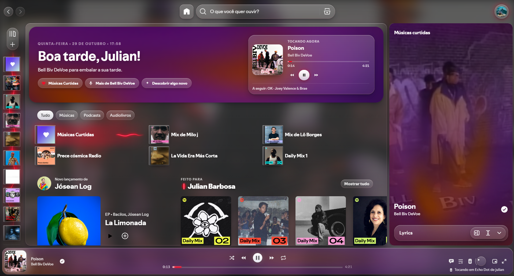
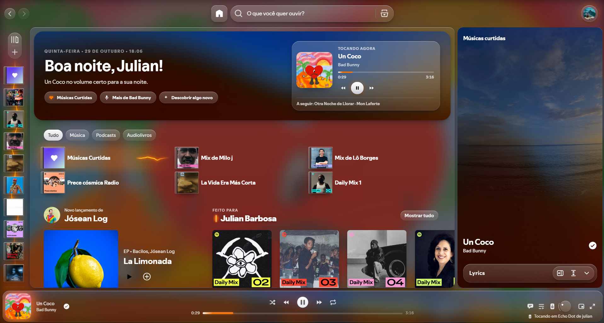
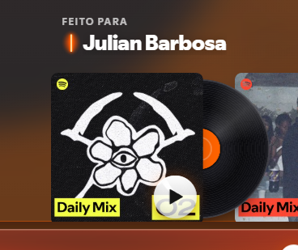
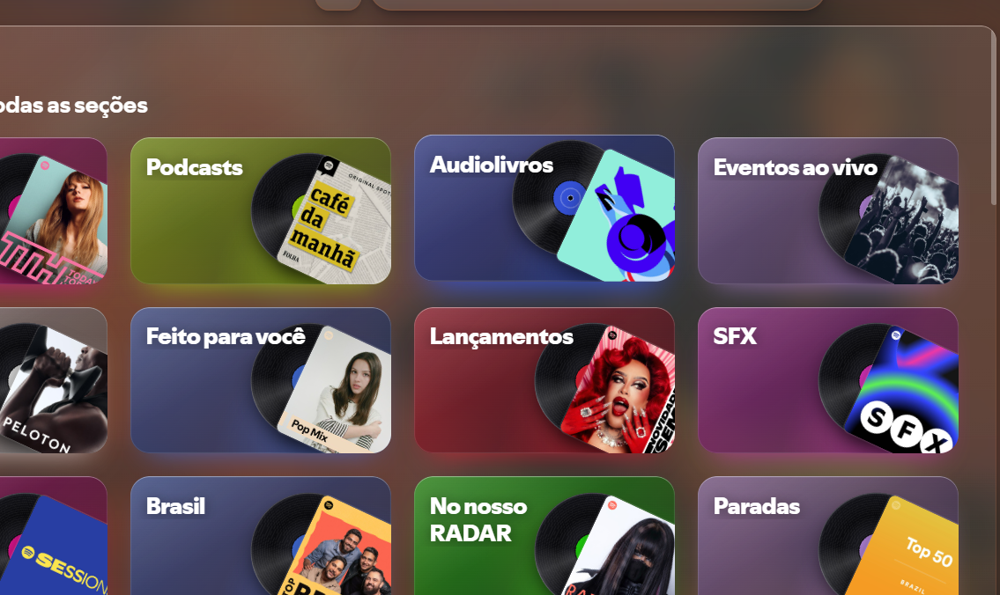
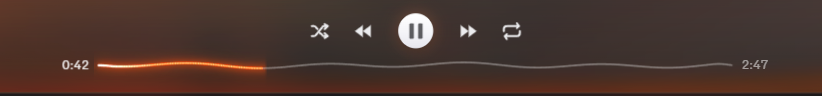
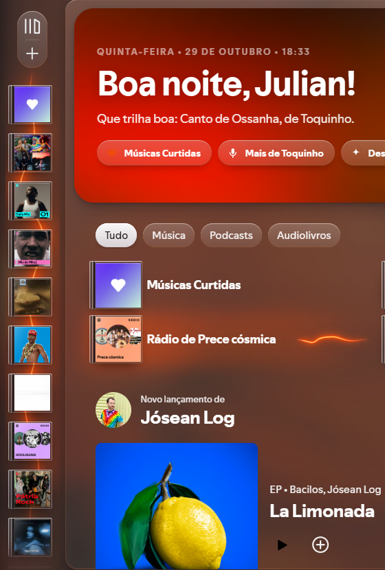
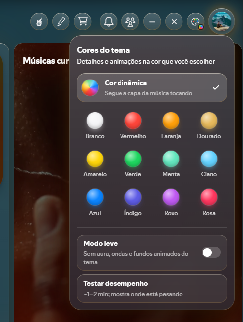

# Spotify Liquid Glass

Um tema de **vidro líquido** para o Spotify no Windows: painéis translúcidos, luz que vem da capa do álbum, cor dinâmica, aura sonora na barra lateral, capas com cara de caixinha de CD (com disco de vinil) e um cabeçalho de boas-vindas na página inicial.

Feito sobre o [Spicetify](https://spicetify.app/) e o tema [Hazy](https://github.com/Astromations/Hazy). É só CSS + uma extensão em JavaScript. Não modifica o programa do Spotify de forma permanente e dá para desfazer com um comando.

▶️ **[Ver vídeo de demonstração (48 s, sem som)](docs/previews/Video_Exemplo.mp4)**





## O que tem

- **Vidro e luz de fundo:** painéis em vidro tingido; a luz em volta das capas e do player vem das cores da música tocando.
- **Cor dinâmica + paleta:** o tema acompanha a capa. Um botão de paleta (aparece ao passar o mouse na foto de perfil) permite fixar outra cor.
- **Barra lateral:** miniaturas com cantos grandes, capas em estilo caixinha de CD e uma **aura sonora** atrás delas que balança com o volume e a batida da música.
- **Player:** barra de progresso colorida, botão de play em pérola, **volume em botão giratório**, ícones próprios.
- **Página inicial:** cabeçalho de boas-vindas (saudação pela hora, data e a música tocando agora) e uma **onda sonora** no atalho do álbum/playlist que está tocando.
- **Barra de tempo em onda:** quando a música não está nos atalhos da página inicial, a barra de progresso vira uma onda que pulsa com as batidas da música (a parte já tocada fica colorida).
- **Modo leve e teste de desempenho:** no botão da paleta, um modo que desliga os efeitos mais pesados e um teste que mede a fluidez e mostra o que está pesando (também pelo **F9**).
- **Cartões com disco de vinil** nas listas de álbuns e playlists.
- **Minimizar e fechar** junto dos botões que aparecem ao passar o mouse na foto de perfil (a barra de título nativa fica escondida; **F8** liga/desliga).
- **Responsivo:** o painel "Tocando agora" se ajusta à altura da janela (a pílula de letras fica sempre visível), a busca encolhe em janelas estreitas e o cabeçalho de boas-vindas compacta.
- Estilo para o cartão de letras do **Spicy Lyrics** (extensão de terceiros, veja Créditos).

### Detalhes

| | |
|---|---|
|  |  |
|  |  |



## Requisitos

- Windows com o Spotify **instalado pelo instalador oficial** (não a versão da Microsoft Store, que o Spicetify não consegue modificar).
- [Spicetify](https://spicetify.app/docs/getting-started) e o tema [Hazy](https://github.com/Astromations/Hazy).
- Testado no Windows com o Spotify de outubro de 2026. Como o Spotify muda os nomes internos a cada versão, após uma atualização grande algo pode precisar de ajuste (abra uma issue).

## Instalação

No PowerShell:

```powershell
# 1) Spicetify
iwr -useb https://raw.githubusercontent.com/spicetify/cli/main/install.ps1 | iex

# 2) Tema Hazy
iwr -useb https://raw.githubusercontent.com/Astromations/Hazy/main/install.ps1 | iex
```

Depois, **copie os dois arquivos deste projeto** (faça backup do `user.css` antigo, se existir):

| Deste projeto | Para |
|---|---|
| `theme/user.css` | `%appdata%\spicetify\Themes\Hazy\user.css` |
| `extensions/liquid-glass.js` | `%appdata%\spicetify\Extensions\liquid-glass.js` |

E aplique:

```powershell
spicetify config current_theme Hazy
spicetify config inject_css 1 replace_colors 1 overwrite_assets 1 inject_theme_js 1
spicetify config extensions liquid-glass.js
spicetify apply
```

> O instalador do Hazy **apaga** a pasta `Themes\Hazy` ao reinstalar. Guarde uma cópia do `user.css` fora dela.

### Uso no dia a dia

- **F8**: mostra/esconde a barra de título nativa do Spotify.
- **F9**: roda o teste de desempenho.
- **Mouse na foto de perfil**: aparecem o lápis (ajustes do Hazy), o carrinho (loja do Spicetify), Novidades, Amigos, minimizar, fechar e a paleta de cores.
- Depois de uma atualização do Spotify: `spicetify backup apply`.
- Para voltar ao Spotify original: `spicetify restore`.

## Estrutura do projeto

```
theme/user.css              arquivo pronto para o Spicetify (gerado)
extensions/liquid-glass.js  extensão (código JS; edite aqui)
src/user.css                fonte do CSS (edite aqui)
tools/build.py              gera theme/user.css a partir de src/user.css e confere a versão da extensão
docs/COMO-FUNCIONA.md       explicação simples de como tudo funciona
docs/DESEMPENHO.md          o que foi feito para o tema ficar leve (e como medir)
docs/previews/              imagens do README
```

### Editando e gerando de novo

1. Edite `src/user.css` (regras de aparência) ou `extensions/liquid-glass.js` (comportamento).
2. Rode `python tools/build.py`. Ele refaz `theme/user.css`, confere se a versão do CSS (`--jc-css-v`) é a que a extensão espera (`JC_CSS_V`; mude os dois juntos quando alterar o CSS de um jeito que a extensão precise saber) e roda `node --check` se o Node estiver instalado.
3. Copie os arquivos para as pastas do Spicetify e rode `spicetify apply` (ou use `spicetify watch -s` para recarregar sozinho).

Para inspecionar o Spotify e achar nomes de classes: `spicetify enable-devtools` e depois **Ctrl+Shift+I** dentro do Spotify.

## Créditos e licenças

- **Spotify Liquid Glass** (este projeto: CSS e extensão) — licença **MIT**, veja `LICENSE`.
- **[Hazy](https://github.com/Astromations/Hazy)**, por Astromations: tema base. Este projeto **não inclui** o código dele; o `user.css` apenas o importa pela internet e acrescenta estilos por cima.
- **[Spicetify](https://github.com/spicetify/cli)**: ferramenta que injeta tema e extensões no Spotify. Não incluída.
- **[Spicy Lyrics](https://github.com/Spikerko/spicy-lyrics)**, por Spikerko (licença AGPL-3.0): extensão que fornece as **letras sincronizadas**. Não incluída aqui e **não é de autoria deste projeto**; o tema só estilizou o cartão e a página dela.
- Este projeto foi desenvolvido com **auxílio de IA** (Claude, da Anthropic): direção, testes no Spotify real, decisões de design e revisão por mim; a escrita e a refatoração do código foram feitas em conjunto com a IA.

## Avisos

- **Projeto não oficial.** Não é afiliado, patrocinado nem aprovado pelo Spotify. "Spotify" é marca da Spotify AB.
- Modificar o cliente do Spotify pode contrariar os termos de uso do serviço. Use por sua conta e risco. O projeto não altera nem contorna nada relacionado a contas, anúncios ou reprodução.
- Fornecido "como está", sem garantias (veja `LICENSE`).

---

### English (short)

**Spotify Liquid Glass** is a "liquid glass" theme for the Windows Spotify desktop client, built on [Spicetify](https://spicetify.app/) and the [Hazy](https://github.com/Astromations/Hazy) theme: translucent panels, album-art-driven lighting, dynamic colour, a sound-reactive aura in the sidebar, CD-case covers with vinyl discs, a welcome header and a responsive Now Playing panel. Install: copy `theme/user.css` to `%appdata%\spicetify\Themes\Hazy\` and `extensions/liquid-glass.js` to `%appdata%\spicetify\Extensions\`, then run `spicetify config extensions liquid-glass.js` and `spicetify apply`. Not affiliated with Spotify. Lyrics come from the separate [Spicy Lyrics](https://github.com/Spikerko/spicy-lyrics) extension (AGPL-3.0), which is not included. Developed with AI assistance (Claude).
